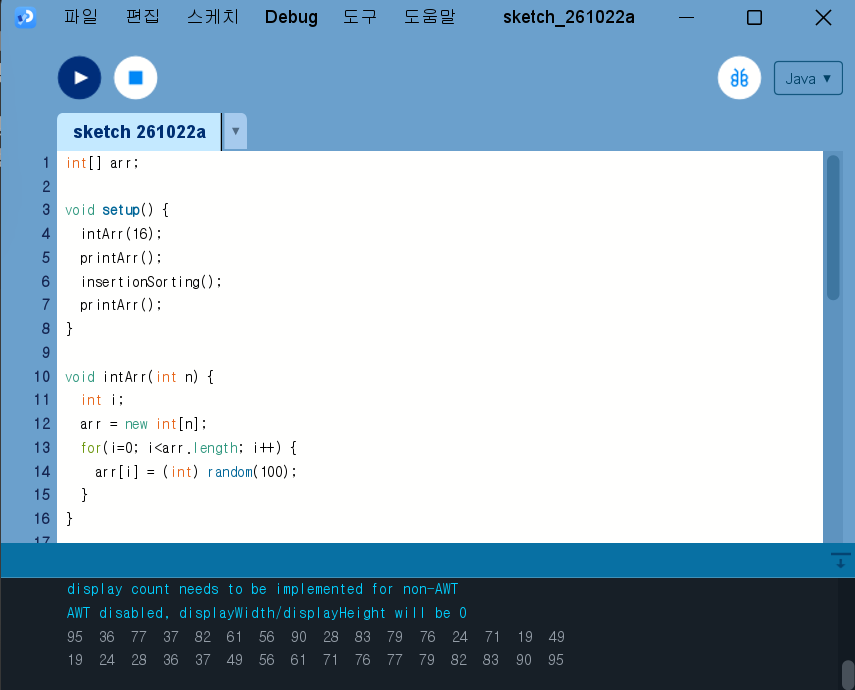
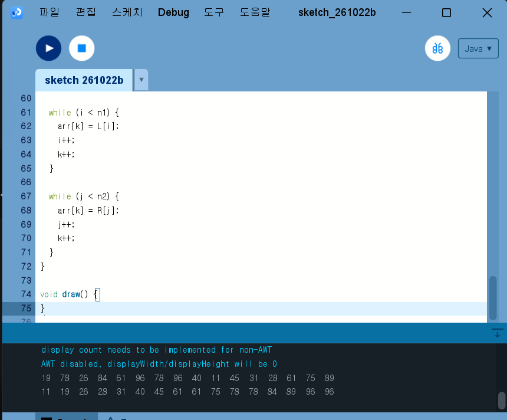
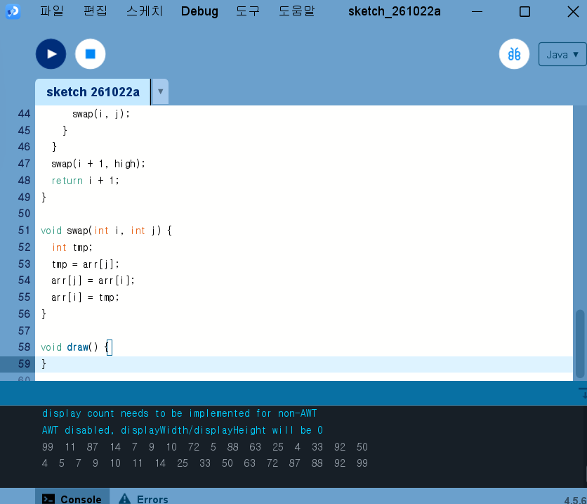
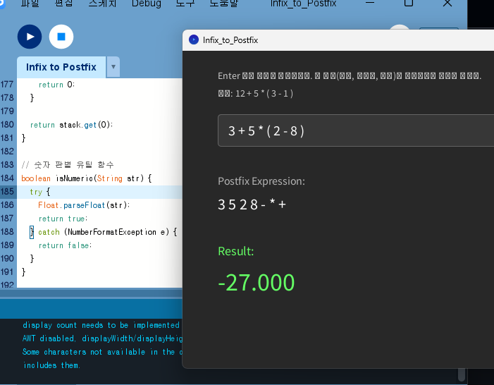

# Algorithm2026

## Homework1

[SelectionSorting](selectionSorting.pde)

[bubbleSort](bubbleSort.pde)

[HeapSort](HeapSort.pde)

[Insertion](Insertion.pde)

[Merge](Merge.pde)

[Quick](Quick.pde)

## Homework2
[SortAnimation](SortAnimation.pde)
https://youtu.be/LeIMAXMhqFM

[Array](Array.pde)
https://youtu.be/HuCLbBGY5so

## Homework3
[BinarySearchTree](BinarySearchTree)
https://youtu.be/bLPoS2Csshc

## Homework4
[Infix_to_Postfix](Infix_to_Postfix.pde)

